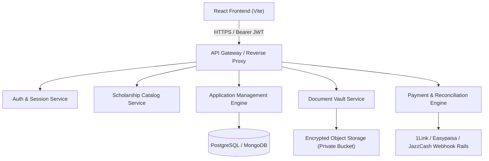

# ScholarBridge Pakistan — Backend Integration Guide & Architecture Contract

> [!CAUTION]
> **Production Security Mandate**: Browser `localStorage` is used solely for client-side prototype persistence and interactive demonstrations. It is **NOT** secure for real CNIC identification documents, banking credentials, or private financial records. All services in `src/services/` are architected with asynchronous promise signatures to be directly swapped for authenticated REST API or GraphQL endpoints.

---

## 1. Architecture Overview

---

## 2. Authentication & Authorization (RBAC)

### Production Authentication Rails:
- **Protocol**: HTTP-Only Secure Cookies with short-lived JWT Access Tokens (15 min) + Refresh Token rotation (7 days).
- **Two-Factor Authentication (2FA)**: SMS OTP via Pakistani telecommunication aggregators (Zong, Jazz, Telenor, Ufone) for CNIC verification.
- **Roles & Permissions**:
  - `student`: Can read published scholarships, submit applications, upload private documents, track own status.
  - `verification_officer`: Can view assigned applications within district jurisdiction, verify/reject document files, request corrections.
  - `steering_committee`: Can approve/award scholarships and allocate disbursement budgets.
  - `super_admin`: Full system configuration, scheme creation, audit inspection.

---

## 3. Future REST Endpoints Contract

All endpoints mirror the configuration defined in `src/config/apiConfig.js`:

### Authentication & Profiles
| Method | Endpoint | Description |
| :--- | :--- | :--- |
| `POST` | `/api/v1/auth/register` | Register new student with validated CNIC & SMS OTP |
| `POST` | `/api/v1/auth/login` | Authenticate student or admin credentials |
| `POST` | `/api/v1/auth/refresh-token` | Rotate JWT access token |
| `POST` | `/api/v1/auth/logout` | Invalidate active refresh tokens |
| `GET` | `/api/v1/students/me` | Fetch authenticated applicant profile |
| `PUT` | `/api/v1/students/me` | Update education history & financial details |

### Scholarships
| Method | Endpoint | Description |
| :--- | :--- | :--- |
| `GET` | `/api/v1/scholarships` | Query published scholarships with filtering, search & pagination |
| `GET` | `/api/v1/scholarships/:id` | Fetch detailed scholarship rules & custom questions |
| `POST` | `/api/v1/admin/scholarships` | Create new scholarship scheme (Admin only) |
| `PUT` | `/api/v1/admin/scholarships/:id` | Update scheme parameters or status |
| `POST` | `/api/v1/admin/scholarships/:id/archive` | Archive closed scholarship cycle |

### Applications
| Method | Endpoint | Description |
| :--- | :--- | :--- |
| `POST` | `/api/v1/applications/draft` | Save or resume in-progress application draft |
| `POST` | `/api/v1/applications` | Submit application; triggers duplicate checks & reference generation |
| `GET` | `/api/v1/applications/my` | Fetch current student's applications |
| `GET` | `/api/v1/applications/:id` | Fetch application details, timeline & remarks |
| `PUT` | `/api/v1/admin/applications/:id/status` | Transition status (Under Review, Approved, Rejected, Awarded) |
| `POST` | `/api/v1/admin/applications/:id/correction` | Issue formal correction request with deadline |
| `POST` | `/api/v1/applications/:id/resubmit` | Candidate resubmission of corrected documents |

### Secure Document Vault
| Method | Endpoint | Description |
| :--- | :--- | :--- |
| `POST` | `/api/v1/documents/presigned-url` | Generate pre-signed URL for direct upload to private cloud storage |
| `POST` | `/api/v1/documents/confirm` | Confirm upload completion and initiate anti-virus scan |
| `GET` | `/api/v1/documents/:id/preview` | Generate time-limited (5 min) watermarked preview URL for reviewer |
| `PUT` | `/api/v1/admin/documents/:id/verify` | Mark verified or rejected with auditor notes |

### Payments & Financial Reconciliation
| Method | Endpoint | Description |
| :--- | :--- | :--- |
| `POST` | `/api/v1/payments/initiate` | Initiate Easypaisa/JazzCash checkout session |
| `POST` | `/api/v1/payments/webhook` | Instant Payment Notification (IPN) webhook handler with signature check |
| `POST` | `/api/v1/admin/payments/:id/reconcile` | Manual bank transfer reconciliation |
| `POST` | `/api/v1/admin/payments/:id/refund` | Trigger simulated or automated refund |

---

## 4. Secure Document Storage Architecture

1. **No Direct Public URLs**: Uploaded identity documents (CNIC, domicile, salary slips) must **never** be stored in public cloud storage buckets.
2. **Pre-signed Uploads**: Client requests a temporary pre-signed S3/GCS PUT URL with strict Content-Type and 2MB limit enforcement.
3. **At-Rest Encryption**: Files encrypted via AWS KMS / GCP KMS with customer-managed keys (AES-256).
4. **Watermarking on Preview**: When an admin previews a document, the server dynamically overlays a transient watermark (`"Confidential Review - Officer ADM-001 - 2026-10-09"`) to prevent data leakage.

---

## 5. Audit Trail & Legal Compliance

Every administrative change appends an immutable entry to the audit log:
- User ID & IP Address
- Timestamp (UTC ISO-8601)
- Previous State vs New State diff
- Cryptographic hash link to previous audit block for tamper resistance
- Compliance with the Prevention of Electronic Crimes Act (PECA 2016).
